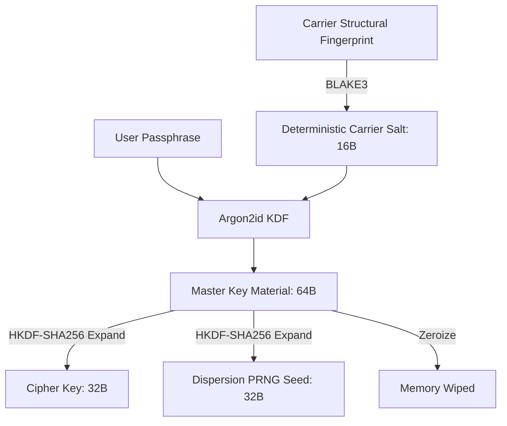

# Bootlegger: Technical Specification (v0.1.0)

## 1. Abstract

**Bootlegger** is a plausible-deniability steganographic archiving system that conceals encrypted secret payloads inside legitimate, standardized cover archives (e.g. POSIX / GNU TAR) without generating file size anomalies, protocol header signatures, or detectable high-entropy localized spikes.

The core design philosophy is **extreme cryptographic paranoia**: the archive contains zero magic bytes, enforces a mathematically verified dilution ratio ("just enough or more, but never less"), and optionally binds the secret to a brittle, bitwise-pinned **Tripwire** Merkle tree that self-destructs if any carrier file is altered, inspected, or re-packed.

---

## 2. Cryptographic Architecture

### 2.1. Key Derivation Pipeline

To achieve zero header overhead, Bootlegger derives salt material deterministically from the carrier's structural fingerprint, eliminating the need to store an unencrypted salt in the archive.

#### Parameters:
* **Argon2id:**
  * Algorithm: `Argon2id` (v0x13)
  * Memory Cost: 32,768 KiB (32 MiB)
  * Time Cost: 3 iterations
  * Parallelism: 1 lane
  * Output Length: 64 bytes
* **Carrier Salt:**
  $$\text{Salt} = \text{BLAKE3}\left(\text{"BOOTLEGGER-CARRIER-SALT-V1\n"} \parallel \bigoplus_{i=1}^N \left(\text{path}_i \parallel \text{size}_i \parallel \text{mtime}_i\right)\right)_{[0..16]}$$
* **HKDF-SHA256 Expansion:**
  * $\text{EncKey} = \text{HKDF-Expand}(\text{Master}, \text{"bootlegger-encryption-key-v1"}, 32)$
  * $\text{PRNGSeed} = \text{HKDF-Expand}(\text{Master}, \text{"bootlegger-dispersion-seed-v1"}, 32)$

### 2.2. AEAD Encryption & Tripwire Pinning

Encryption is performed using **ChaCha20-Poly1305** (`RFC 8439`):
* **Nonce:** 12 cryptographically random bytes generated via OS CSPRNG.
* **Additional Authenticated Data (AAD):**
  * When Tripwire is **Enabled**: $\text{AAD} = [0x01] \parallel \text{TripwireDigest}_{32\text{B}}$
  * When Tripwire is **Disabled**: $\text{AAD} = [0x00]$
* **Bundle Structure:**
  $$\text{Bundle} = \text{Nonce} \, (12\text{B}) \parallel \text{Ciphertext} \, (N\text{B}) \parallel \text{Poly1305 Tag} \, (16\text{B})$$

---

## 3. Storage Vector: POSIX TAR Block Slack

### 3.1. Block Alignment & Slack Formulation

POSIX / GNU TAR archives are composed of contiguous 512-byte blocks. For every regular file entry of length $L_i$ bytes:
$$\text{Allocated Data Bytes} = \left\lceil \frac{L_i}{512} \right\rceil \times 512$$
$$\text{Slack Capacity } S_i = \left(512 - (L_i \pmod{512})\right) \pmod{512}$$

Standard TAR extractors (`GNU tar`, `bsdtar`, `7-zip`, Python `tarfile`) read exactly $L_i$ bytes as specified in the octal header field `size [124..136]` and unconditionally seek past the remaining $S_i$ padding bytes.

### 3.2. Micro-Dispersion Scheduler

1. The encrypted bundle is prepended with a 4-byte length prefix masked with a stream generated from `PRNGSeed`:
   $$\text{MaskedLength} = \text{Length} \oplus \text{ChaCha20PRNG}(\text{PRNGSeed})_{[0..4]}$$
2. The unified stream $\text{Stream} = \text{MaskedLength} \parallel \text{Bundle}$ is sliced into micro-shards.
3. Micro-shards are distributed across the natural slack slots $S_1, S_2, \dots, S_N$.
4. Any remaining unused slack bytes in slot $i$ are filled with pseudo-random noise seeded by the PRNG to match the entropy profile of standard data or null padding.

---

## 4. Security Subsystems

### 4.1. Dilution Accountant

To prevent statistical detectability, the secret cannot exceed a defined dilution ratio relative to the decoy cover volume:
$$\text{Effective Dilution Ratio} = \frac{\text{SecretSize} + \text{Overhead}}{\sum_{i=1}^N L_i} \le \text{MaxDilutionRatio} \quad (\text{default: } 3.0\%)$$

If $\text{SecretSize} + \text{Overhead} > \text{SafeStealthCapacity}$, Bootlegger **aborts execution** with `InsufficientCapacity`:
* Calculates exact additional decoy files needed:
  $$\Delta_{\text{files}} = \left\lceil \frac{\text{Deficit}}{\text{SafeBudgetPerFile}} \right\rceil$$

### 4.2. Tripwire Anti-Tamper Engine

The Tripwire engine constructs a canonical BLAKE3 tree over all decoy entries:
$$\text{TripwireDigest} = \text{BLAKE3}\left(\text{"BOOTLEGGER-TRIPWIRE-V1\n"} \parallel N \parallel \bigoplus_{\text{sorted}(i)} \left(\text{path}_i \parallel \text{size}_i \parallel \text{BLAKE3}(\text{content}_i) \parallel \text{mtime}_i\right)\right)$$

If an investigator or attacker modifies 1 byte in any cover file, deletes a file, adds a file, or alters timestamps:
1. Candidate $\text{TripwireDigest}' \ne \text{TripwireDigest}$.
2. Poly1305 MAC authentication fails immediately during AEAD decryption.
3. No secret plaintext is ever reconstructed or released into memory.
